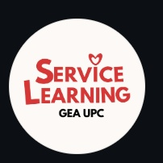

  

  # ¡Hola! Somos Service Learning GEA UPC ❤️

  **Aprendemos, compartimos y transformamos juntos.**

  Una comunidad que conecta el aprendizaje con el servicio y la acción social.
  Impulsamos experiencias de voluntariado junto a **Casa Generación**.

---

## 🌱 ¿Qué es Service Learning?

Service Learning es una experiencia que conecta el aprendizaje con el compromiso social. A través del voluntariado, buscamos poner nuestros conocimientos y habilidades al servicio de la comunidad, mientras aprendemos de las personas y las experiencias que compartimos.

Creemos que **cada pequeño aporte cuenta** y que el aprendizaje tiene un impacto mayor cuando se construye con otros.

## ❤️ Lo que nos mueve

- **Aprender haciendo:** aplicar conocimientos y desarrollar nuevas habilidades en experiencias reales.
- **Servir en comunidad:** compartir tiempo, talentos e ideas para apoyar iniciativas sociales.
- **Crecer juntos:** fomentar la empatía, el trabajo en equipo y el compromiso con nuestro entorno.

## 📸 Nuestras actividades

Realizamos y difundimos iniciativas de voluntariado, encuentros de integración, talleres y campañas solidarias vinculadas a nuestra comunidad y a Casa Generación.

Puedes conocer nuestras experiencias y próximas novedades a través de nuestras redes sociales.

## 🙌 ¿Quieres ser voluntario?

¡Nos encantará que formes parte de esta experiencia!

1. **Conócenos:** descubre el propósito de Service Learning y nuestras actividades.
2. **Infórmate:** revisa las convocatorias y los requisitos vigentes.
3. **Participa:** sigue el proceso de incorporación indicado en cada convocatoria.
4. **Comparte tu talento:** contribuye con tus conocimientos, tiempo y ganas de aprender.

> Las convocatorias, condiciones de participación y canales de inscripción se comunicarán por los medios del programa.

## 🎁 ¿Cómo puedes apoyarnos?

Además del voluntariado, puedes colaborar difundiendo las actividades, participando en campañas solidarias o consultando las necesidades que el equipo anuncie.

Los **aportes económicos**, cuando estén habilitados, deben realizarse únicamente mediante los canales autorizados y comunicados por la **Comisión de Finanzas**. Este perfil de GitHub no recibe pagos ni publica cuentas o códigos QR de donación.

## 💻 ¿Qué estamos construyendo?

Estamos trabajando en una **plataforma web responsive** para que voluntarios e interesados puedan conocer el programa y sus actividades, explorar el impacto de las iniciativas, descubrir formas de participar y consultar mecanismos de apoyo.

En esta organización compartiremos los repositorios y recursos técnicos que el equipo decida publicar.

## 💌 Mantengámonos conectados

**Instagram:** [@geaupc](https://www.instagram.com/geaupc/) · [@voluntariado_geaupc](https://www.instagram.com/voluntariado_geaupc/)

  ---

  ### Juntos, cada pequeño sueño cuenta. ❤️

  **Service Learning · GEA UPC**

